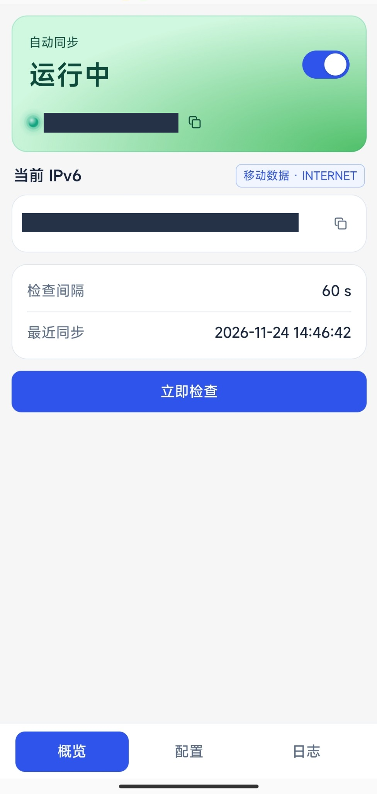
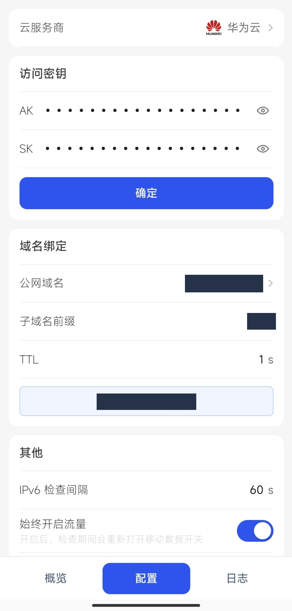
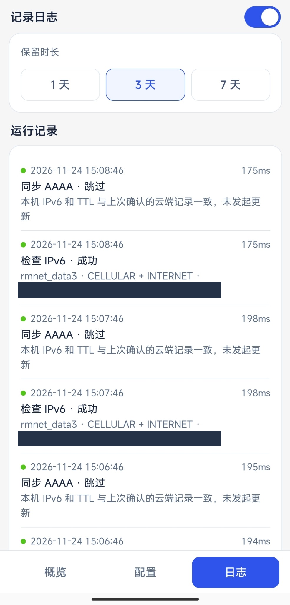

# Android IPv6 DDNS

[简体中文](README.md) · English

Android IPv6 DDNS detects the global IPv6 address of an Android phone’s cellular connection and keeps a domain’s AAAA record pointed at that address.

- Start at boot, check on a schedule, or run a manual check. The auto-sync setting persists across reboots.
- Configure the domain, TTL, and check interval in the WebUI, and view the current address and runtime logs.
- Optional network recovery can re-enable mobile data, reconnect the cellular network, and use airplane mode as a fallback.

## WebUI preview

| Overview | Configuration | Logs |
| :---: | :---: | :---: |
|  |  |  |

## Compatibility

| Requirement | Current support |
| --- | --- |
| Root environment | KernelSU or KernelSU Next with module WebUI support. Verified on a Xiaomi Mi 10S (`thyme`) running KernelSU Next. |
| DNS provider | Huawei Cloud Public DNS. Requires an existing public zone and an AK/SK that can list zones and read, create, and update AAAA records. |
| CPU architectures | `arm64-v8a`, `armeabi-v7a`, and `x86_64`. |
| Network | The default mobile-data SIM must be able to obtain a global IPv6 address. |

> [!WARNING]
> Flashing a root module carries risk. Back up your important data and current boot image, and make sure you have a way to recover the device before flashing.

## Install or upgrade

1. Download the `Android-IPv6-DDNS-v1.0.0.zip` release asset. GitHub’s automatically generated source archives are for browsing or building the code. [Releases](https://github.com/iSemmering/android-ipv6-ddns/releases)
2. Select the ZIP under **Modules** in the KernelSU manager, install it, and reboot.
3. To upgrade, install the new ZIP over the existing module and reboot once. This preserves your configuration and logs. Uninstalling first may remove the module’s data in `/data/adb/ipv6-ddns/`.

## Configure

1. Open the **IPv6 DDNS** module’s WebUI. In **Configuration** (配置), enter the Huawei Cloud AK and SK, then select **Confirm** (确定) to load public zones.
2. Select a public zone and set the subdomain prefix, TTL in seconds, and IPv6 check interval. For example, the prefix `phone` and zone `example.com` form `phone.example.com`.
3. Select **Save configuration** (保存配置). Leaving the page discards unsaved changes to the domain binding and other settings.
4. In **Overview** (概览), enable **Auto sync** (自动同步). Use **Check now** (立即检查) to verify it. Updates are skipped when the IPv6 address and TTL already match the record.

- Use a dedicated subdomain. If an AAAA record already exists for that name, verify what it is used for before confirming that the module can manage it.
- **Keep mobile data on** (始终开启流量) re-enables cellular data when a check finds it disabled. Reconnecting cellular data or using the airplane mode fallback can temporarily interrupt connectivity and remote access.
- A successful AAAA update confirms that the DNS record was updated. Inbound connectivity also depends on the carrier, firewall, and service running on the phone.
- The module stores the AK/SK and runtime configuration on the device. Remove credentials and other sensitive details before filing issues or sharing logs.

## Build from source

On macOS or Linux, install Go 1.23 or later, `zip`, and `unzip`, then run the following commands.

```sh
git clone https://github.com/iSemmering/android-ipv6-ddns.git
cd android-ipv6-ddns
sh build.sh
```

The script runs `go test ./...` and `go vet ./...`, builds binaries for all three architectures, and creates `dist/Android-IPv6-DDNS-v1.0.0.zip`. The filename uses the version in `module/module.prop`.

## License and feedback

The project code is licensed under MIT. Retain the copyright and license notices when redistributing it. [LICENSE](LICENSE)

Include your device model, Android version, KernelSU version, module version, and relevant logs in bug reports. [GitHub Issues](https://github.com/iSemmering/android-ipv6-ddns/issues)

Author **iSemmering** · [semmering@163.com](mailto:semmering@163.com)
