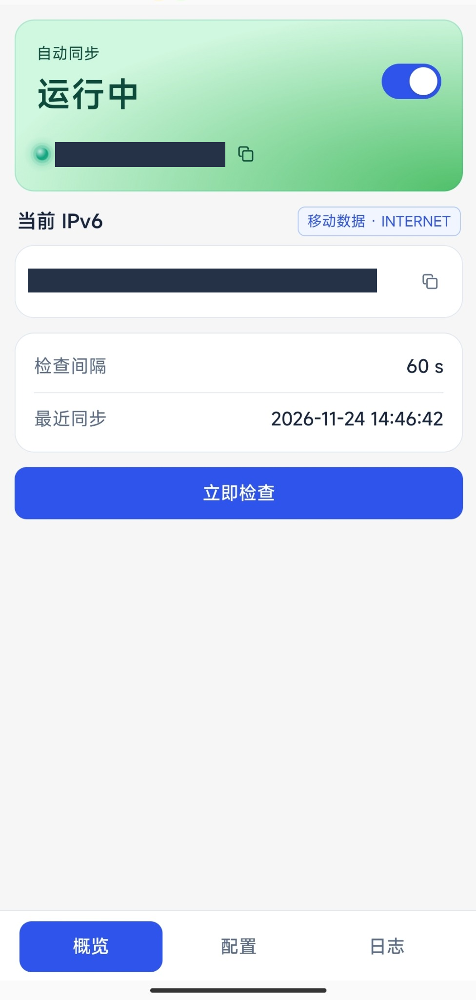
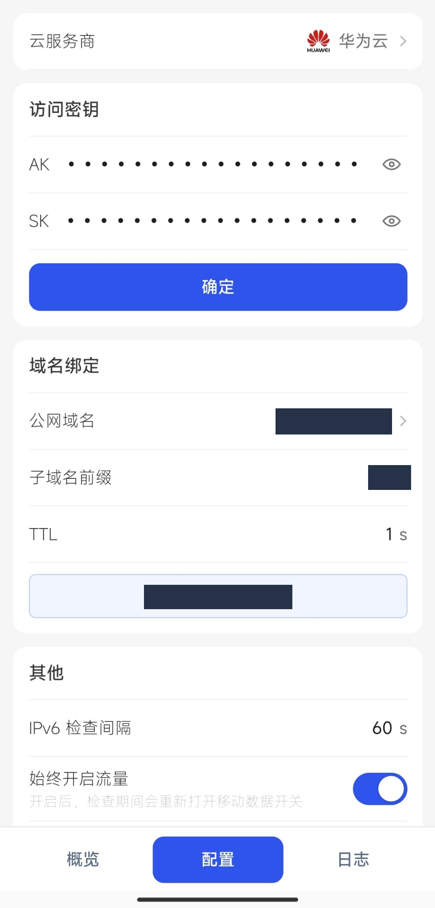
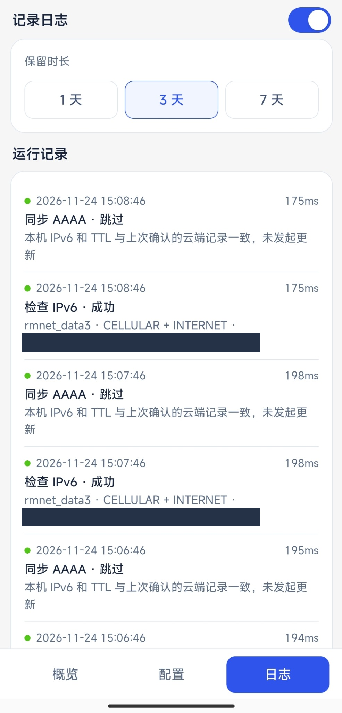

# Android IPv6 DDNS

简体中文 · [English](README.en.md)

Android 手机上的 IPv6 动态 DNS 同步工具。模块检测移动数据网络的全局 IPv6 地址，并将域名的 AAAA 记录同步到当前地址。

- 支持开机自启、定时检查和手动检查。自动同步开关在重启后保留。
- 通过 WebUI 配置域名、TTL 和检查间隔，查看当前 IPv6 与运行日志。
- 可选的网络恢复功能支持重新开启移动数据、重连移动网络和飞行模式兜底。

## 界面预览

| 概览 | 配置 | 日志 |
| :---: | :---: | :---: |
|  |  |  |

## 兼容性

| 项目 | 当前支持 |
| --- | --- |
| Root 环境 | 支持模块 WebUI 的 KernelSU 系列。已在小米 10S（`thyme`）的 KernelSU Next 上验证。 |
| DNS 服务商 | 华为云公网 DNS，需要已有公网域名及可查询域名、读取、创建和更新 AAAA 记录的 AK/SK。后期再考虑是否支持阿里云、腾讯云、京东云 |
| 处理器架构 | `arm64-v8a`、`armeabi-v7a`、`x86_64`。 |
| 网络 | 默认数据 SIM 卡的蜂窝网络需要能获取全局 IPv6 地址。 |

> [!WARNING]
> 刷入 Root 模块存在风险。请先备份重要数据和当前启动镜像，确认有可用的恢复手段后再刷入。

## 安装与升级

1. 下载发布页面的附件 `Android-IPv6-DDNS-v1.0.0.zip`。GitHub 自动生成的源码归档用于查看和构建源码。 [Releases](https://github.com/iSemmering/android-ipv6-ddns/releases)
2. 在 KernelSU 管理器的「模块」页选中 ZIP 安装，完成后重启手机。
3. 升级时直接覆盖刷入新版 ZIP，再重启一次。配置和日志会保留。先卸载可能清除保存在 `/data/adb/ipv6-ddns/` 的模块数据。

## 配置

1. 打开 **IPv6 DDNS** 模块的 WebUI，在「配置」页填写华为云 AK/SK，点击「确定」获取可选的公网域名。
2. 选择公网域名，填写子域名前缀、TTL（秒）和 IPv6 检查间隔。例如，前缀 `phone` 与域名 `example.com` 会组成 `phone.example.com`。
3. 点击「保存配置」。离开配置页会还原未保存的域名绑定和其他设置。
4. 回到「概览」开启「自动同步」，可点击「立即检查」验证。IPv6 和 TTL 与现有记录一致时会跳过更新。

- 使用专用子域名。已有同名 AAAA 记录时，请检查其用途，再按界面提示确认接管。
- 「始终开启流量」会在检查发现移动数据关闭时将其重新打开。重连和飞行模式兜底可能暂时中断移动网络与远程连接。
- AAAA 同步成功表示 DNS 记录已更新。实际能否从公网访问，还取决于运营商网络、防火墙和手机上的服务。
- AK/SK 和运行配置保存在手机的模块数据目录中。提交问题或分享日志时请去掉密钥和其他敏感信息。

## 从源码构建

在 macOS 或 Linux 上准备 Go 1.23 或以上、`zip` 和 `unzip`，然后运行以下命令。

```sh
git clone https://github.com/iSemmering/android-ipv6-ddns.git
cd android-ipv6-ddns
sh build.sh
```

构建脚本会运行 `go test ./...` 和 `go vet ./...`，编译三个架构的程序，并生成 `dist/Android-IPv6-DDNS-v1.0.0.zip`。文件名中的版本取自 `module/module.prop`。

## 许可证与反馈

项目代码采用 MIT 许可证。分发时请保留版权声明和许可文本。 [LICENSE](LICENSE)

提交问题时请附上机型、Android 版本、KernelSU 版本、模块版本和相关日志。 [GitHub Issues](https://github.com/iSemmering/android-ipv6-ddns/issues)

作者 **iSemmering** · [semmering@163.com](mailto:semmering@163.com)
